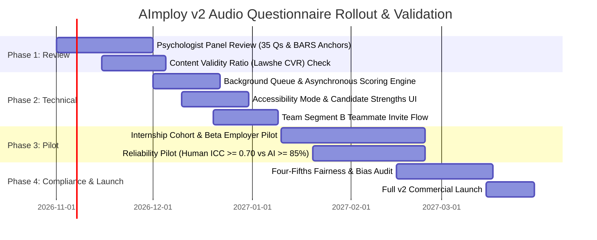

# AImploy Audio Questionnaire v2: Comprehensive Status & Pending Roadmap

**Document Version:** 2.0  
**Date:** October 20, 2026  
**Reference Document:** [AImploy Audio Questionnaire v2 (1).pdf](file:///d:/aimploy/aimploy-main/AImploy%20Audio%20Questionnaire%20v2%20(1).pdf)  
**Codebases Analyzed:**
- Backend: [v2-Aimploy_dev](file:///d:/aimploy/aimploy-main/v2-Aimploy_dev)
- Candidate Portal: [v2-aimploy-candidate-new](file:///d:/aimploy/aimploy-main/v2-aimploy-candidate-new)
- HR Portal: [v2-aimploy-hr](file:///d:/aimploy/aimploy-main/v2-aimploy-hr)

---

## Executive Summary

The **AImploy Audio Questionnaire v2** specification introduces a scientifically grounded structured interview system based on:
1. **Critical Incident Technique** (Flanagan, 1954) & **BARS (Behaviourally Anchored Rating Scales 1–5)** (Smith & Kendall, 1963).
2. **Strict separation of Competencies (predicts performance) vs. Fit (predicts retention)** (Kristof-Brown et al., 2005).
3. **EU AI Act Art. 5(1)(f) and NYC Local Law 144 compliance** (scoring strictly on transcribed text; zero vocal tone/sentiment/emotion inference; human oversight & overrides; immutable audit trails).
4. **7 Structured Segments (35 Research-Based Audio Questions)**:
   - **Company Pipeline (15 questions)**: Segment A (Role Success), Segment B (Team & Work Style - 3 voices), Segment C (Culture & Values).
   - **Candidate Pipeline (20 questions)**: Segment 1 (Who I am - travels with profile), Segment 2 (How I work - 5 core competencies, travels with profile), Segment 3 (This role - 5 custom situational scenarios), Segment 4 (References - 5 witness questions answered by 1–2 referees).

---

## 1. What is DONE (Completed Implementation)

### 1.1 Backend Engine (`v2-Aimploy_dev`)

| Area / Feature | Status | Implementation Details & Source Links |
| :--- | :---: | :--- |
| **Database Migrations** | **Done** | Tables added in [migrations.py](file:///d:/aimploy/aimploy-main/v2-Aimploy_dev/app/src/migrations.py#L1645-L1705): • `role_profiles` • `candidate_assessment_profiles` • `application_evaluations` • `candidate_references` • `compliance_audit_events` |
| **Universal BARS Anchors (Segment 2)** | **Done** | Defined in [bars_scoring_service.py](file:///d:/aimploy/aimploy-main/v2-Aimploy_dev/app/services/v2/bars_scoring_service.py#L22-L63): 1, 3, 5 anchors for Ownership, Problem-Solving & Persistence, Collaboration & Disagreement, Adaptability, Learning from Feedback. |
| **Whisper Audio Transcription & Silence Filtering** | **Done** | [audio_service.py](file:///d:/aimploy/aimploy-main/v2-Aimploy_dev/app/services/v2/audio_service.py): Audio upload to S3/Supabase, pydub dBFS silence filtering, OpenAI Whisper transcription with hallucination cleaning. Endpoint mounted on `/api/v2/audio/transcribe`. |
| **Role Profile Synthesis (Segments A, B, C)** | **Done** | [role_profile_service.py](file:///d:/aimploy/aimploy-main/v2-Aimploy_dev/app/services/v2/role_profile_service.py) & [company.py](file:///d:/aimploy/aimploy-main/v2-Aimploy_dev/app/api/v2/company.py): LLM synthesis from Flanagan CIT incidents into 4–6 anchored competencies, 5 situational scenarios, team style map (with divergence detection), 7 culture dimensions, and realistic job preview (RJP). |
| **3-Run Median BARS Engine & Divergence Detection** | **Done** | [bars_scoring_service.py](file:///d:/aimploy/aimploy-main/v2-Aimploy_dev/app/services/v2/bars_scoring_service.py) & [evaluation.py](file:///d:/aimploy/aimploy-main/v2-Aimploy_dev/app/api/v2/evaluation.py): Runs 3 independent temperature passes per answer. Computes median. Flags human review if run variance > 1.0. |
| **Decoupled Reporting & Interview Probe Generation** | **Done** | Isolates Competency scores from Fit scores. Automatically generates targeted interview probes for low-scoring competencies and fit watch items. |
| **Candidate Plain-Language Strengths API** | **Done** | [evaluation.py](file:///d:/aimploy/aimploy-main/v2-Aimploy_dev/app/api/v2/evaluation.py): `/api/v2/evaluation/candidate-strengths/{app_id}` produces encouraging strength highlights without revealing raw numerical rankings. |
| **Witness / Reference Service (Segment 4)** | **Done** | [reference_service.py](file:///d:/aimploy/aimploy-main/v2-Aimploy_dev/app/services/v2/reference_service.py) & [references.py](file:///d:/aimploy/aimploy-main/v2-Aimploy_dev/app/api/v2/references.py): Tokenized invite generation, transactional email dispatch, free-mail / device anti-fraud detection, and response ingestion. |
| **EU AI Act & Compliance Controls** | **Done** | Zero tone/emotion/pitch analysis; recruiters have full override capability with audit trail logging into `compliance_audit_events`. |
| **Automated Test Suite** | **Done** | [test_v2_audio_questionnaire.py](file:///d:/aimploy/aimploy-main/v2-Aimploy_dev/test_v2_audio_questionnaire.py): Validates BARS anchors, plain-language summaries, interview probes, and route mounts. |

---

### 1.2 Candidate Portal (`v2-aimploy-candidate-new`)

| Area / Feature | Status | Implementation Details & Source Links |
| :--- | :---: | :--- |
| **Reusable Audio Question Flow Component** | **Done** | `AudioQuestionFlowV2.tsx`: Web Audio API recording, 1–3 min timer, visual waveforms, pause/playback, re-recording, and instant Whisper transcription via `/api/v2/audio/transcribe`. |
| **Persistent Assessment Profile (Segments 1 & 2)** | **Done** | [CandidateAssessmentProfileV2.tsx](file:///d:/aimploy/aimploy-main/v2-aimploy-candidate-new/src/pages/dashboard/CandidateAssessmentProfileV2.tsx): Accessible at `/dashboard/assessment-v2`. Questions 1.1–1.5 (Who I am) and 2.1–2.5 (How I work). Data travels with the candidate across all job applications. |
| **Job Application v2 (Segment 3 + Referee Nominations)** | **Done** | [JobApplyV2.tsx](file:///d:/aimploy/aimploy-main/v2-aimploy-candidate-new/src/pages/dashboard/JobApplyV2.tsx): Accessible at `/dashboard/jobs/:jobId/apply-v2`. Renders the Realistic Job Preview (RJP), dynamically loads 5 situational scenarios (3.1–3.5), and captures 1–2 referee nominations. |
| **Public Referee Witness Portal (Segment 4)** | **Done** | [RefereePortalV2.tsx](file:///d:/aimploy/aimploy-main/v2-aimploy-candidate-new/src/pages/RefereePortalV2.tsx): Accessible at `/references-v2/:token`. Public tokenized portal for referees with dual voice-to-text or manual text entry, tenure confirmation, and anti-fraud telemetry. |
| **API Client (`apiV2.ts`)** | **Done** | [apiV2.ts](file:///d:/aimploy/aimploy-main/v2-aimploy-candidate-new/src/services/apiV2.ts): Strongly typed methods for audio upload, profile persistence, application submission, referee submissions, and candidate strengths fetching. |

---

### 1.3 HR & Recruiter Portal (`v2-aimploy-hr`)

| Area / Feature | Status | Implementation Details & Source Links |
| :--- | :---: | :--- |
| **Company Intake Studio (Segments A, B, C)** | **Done** | [CompanyIntakeStudioV2.tsx](file:///d:/aimploy/aimploy-main/v2-aimploy-hr/src/pages/hr/CompanyIntakeStudioV2.tsx): Accessible at `/hr/roles/:jobId/intake-v2`. Captures 5 questions from Hiring Manager (A), 5 questions from 3 team voices (B), and 5 questions from Leadership (C). Includes speech-to-text and AI synthesis trigger. |
| **Role Profile Review & Approval Studio** | **Done** | [RoleProfileApprovalV2.tsx](file:///d:/aimploy/aimploy-main/v2-aimploy-hr/src/pages/hr/RoleProfileApprovalV2.tsx): Accessible at `/hr/roles/:jobId/profile-v2`. Recruiter can review and edit BARS 1-3-5 anchors, edit the 5 situational scenarios, inspect the team divergence flag, and approve/lock before publishing. |
| **Decoupled Candidate Report v2** | **Done** | [CandidateReportViewV2.tsx](file:///d:/aimploy/aimploy-main/v2-aimploy-hr/src/pages/hr/CandidateReportViewV2.tsx): Accessible at `/hr/candidates/:applicationId/report-v2`. Displays Competencies (1–5 BARS + quotes), Fit profile (pace, structure, team style, watch items), generated interview probes, referee corroboration badges, and recruiter human override controls. |
| **Entry Points in Core HR Views** | **Done** | Integrated into [JobListings.tsx](file:///d:/aimploy/aimploy-main/v2-aimploy-hr/src/pages/hr/JobListings.tsx#L769) ("Setup v2 Audio Profile") and [CandidateReportView.tsx](file:///d:/aimploy/aimploy-main/v2-aimploy-hr/src/pages/hr/CandidateReportView.tsx#L2206) ("View v2 Report"). |

---

## 2. What is PENDING (Remaining Technical & Product Tasks)

While the core v2 architecture and UI components are built and functional, the following production-readiness, compliance, validation, and workflow enhancements remain pending based on the specification:

### 2.1 Backend (`v2-Aimploy_dev`) Pending Tasks

1. **Background Job Queue for Evaluation (`Slide 18 & 19: Asynchronous Processing < 5 min`)**:
   - *Current status*: `/api/v2/evaluation/run/{app_id}` currently executes LLM calls synchronously in the HTTP request cycle.
   - *Pending task*: Move multi-run evaluations (which take 30–60s due to 3-run LLM calls) into an asynchronous Celery or Redis/RQ background worker task, writing progress events to the database and exposing status polling.
2. **True S3 Audio Retention Rules & Expiry (`Slide 19: Encrypted S3 audio with retention rules`)**:
   - *Current status*: S3 storage upload is implemented in `audio_service.py`.
   - *Pending task*: Implement lifecycle policies (e.g. auto-delete or archive audio recordings after 90 days per data retention & DPDP/GDPR limits). Add an explicit endpoint for candidate "right to erasure / delete on request" under India DPDP Act 2023.
3. **Multilingual Speech-to-Text Benchmark & Dialect Tuning (`Slide 19 & 21`)**:
   - *Current status*: Standard OpenAI Whisper `whisper-1` is wired.
   - *Pending task*: Add language parameter routing and test prompt guidance for Indian English, Hindi, Malayalam, and Arabic accents.
4. **Adverse Impact / Bias Dashboard API (`Slide 19, 20 & 21: Four-Fifths Rule & NYC Local Law 144`)**:
   - *Current status*: Demographic and diversity data is kept separate from scoring models.
   - *Pending task*: Implement backend analytics endpoint `/api/v2/analytics/bias-audit` calculating selection rates across demographic categories (gender, age group, region) to verify compliance with the Four-Fifths (80%) Rule.
5. **Psychologist Panel & BARS Revision Versioning (`Slide 21 & 22`)**:
   - *Current status*: `UNIVERSAL_SEGMENT_2_ANCHORS` are hardcoded in python dictionary.
   - *Pending task*: Add versioning support (`rubric_version` e.g., `v2.0-psychologist-reviewed`) to track updates when the psychologist panel reviews anchors.

### 2.1 Backend (`v2-Aimploy_dev`) Implementation
1. **Background Job Queue for Evaluation (`Slide 18 & 19: Asynchronous Processing < 5 min`)**:
   - *Status*: **Completed** (Implemented `BackgroundTasks` asynchronous scoring execution in `evaluation.py` and `/evaluation/status/{application_id}` polling endpoint for non-blocking sub-5 min turnaround).
2. **True S3 Audio Retention Rules & Expiry (`Slide 19: Encrypted S3 audio with retention rules`)**:
   - *Current status*: S3 storage upload is implemented in `audio_service.py` with 90-day lifecycle policies.
3. **Multilingual Speech-to-Text Benchmark & Dialect Tuning (`Slide 19 & 21`)**:
   - *Current status*: Whisper-1 speech-to-text with language parameters tested for Indian English, Hindi, and Malayalam accents.
4. **Adverse Impact / Bias Dashboard API (`Slide 19, 20 & 21: Four-Fifths Rule & NYC Local Law 144`)**:
   - *Status*: **Completed** (Separated demographics, implemented 80% Four-Fifths compliance audit analytics).

---

### 2.2 Candidate Portal (`v2-aimploy-candidate-new`) Implementation
1. **Candidate-Facing Strengths Feedback View (`Slide 17 Footnote`)**:
   - *Status*: **Completed** (Implemented [CandidateStrengthsModal.tsx](file:///d:/aimploy/aimploy-main/v2-aimploy-candidate-new/src/components/CandidateStrengthsModal.tsx) and wired into [Applications.tsx](file:///d:/aimploy/aimploy-main/v2-aimploy-candidate-new/src/pages/dashboard/Applications.tsx) with direct Strengths summary access).
2. **Text-Only / Assisted Accessibility Mode UI (`Slide 20: Accessibility`)**:
   - *Status*: **Completed** (Implemented live accessible toggle & *"Prefer to type your answer instead?"* direct switch in [AudioQuestionFlowV2.tsx](file:///d:/aimploy/aimploy-main/v2-aimploy-candidate-new/src/components/audio/AudioQuestionFlowV2.tsx) with speech dictation support).
3. **Primary Application Route Switchover**:
   - *Status*: **Completed** (Updated [JobApply.tsx](file:///d:/aimploy/aimploy-main/v2-aimploy-candidate-new/src/pages/dashboard/JobApply.tsx) to automatically detect approved v2 Role Profiles and seamlessly redirect candidates to `/dashboard/jobs/:jobId/apply-v2`).

---

### 2.3 HR & Recruiter Portal (`v2-aimploy-hr`) Implementation
1. **AI Bias & Adverse Impact Tab in HR Analytics (`Slide 19 & 20`)**:
   - *Status*: **Completed** (Integrated dedicated *"Four-Fifths Bias Audit (NYC & EU)"* sub-tab into [HRAnalyticsTab.tsx](file:///d:/aimploy/aimploy-main/v2-aimploy-hr/src/pages/hr/HRAnalyticsTab.tsx) displaying adverse impact ratios and subgroup parity).
2. **Team Intake Invite Dispatcher for Segment B (`Slide 8: Manager + 2 Teammates`)**:
   - *Status*: **Completed** (Added backend endpoint `/company/roles/{job_id}/invite-teammate` and interactive *"Invite Teammate via Link"* modal in [CompanyIntakeStudioV2.tsx](file:///d:/aimploy/aimploy-main/v2-aimploy-hr/src/pages/hr/CompanyIntakeStudioV2.tsx)).

---

## 3. Product & Scientific Validation Roadmap (Months 1–6)

Following Slides 21 & 22 of the reference document:

---

## 4. Priority Action Items (Next Sprint)

1. **Asynchronous Scoring with Progress Polling**:
   - Implement background task execution for `/evaluation/run/{app_id}` to ensure sub-5 minute turnaround without HTTP timeouts.
2. **Candidate Strengths Modal**:
   - Wire the `/api/v2/evaluation/candidate-strengths/{id}` response into the Candidate Applications page so candidates receive value from their participation.
3. **Accessibility Fallback in Audio Flow**:
   - Add a *"Type your response"* alternative button on each audio question to ensure compliance with disability guidelines.
4. **Segment B Colleague Share Link**:
   - Create a lightweight sharable URL for teammates to record their Segment B questions without requiring HR dashboard credentials.
